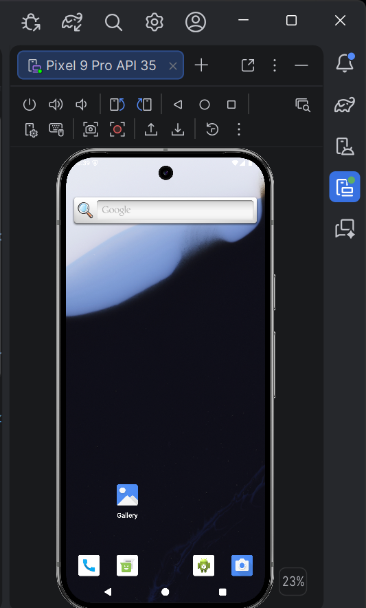
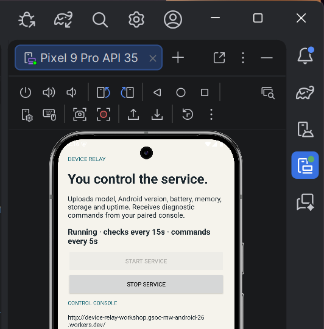
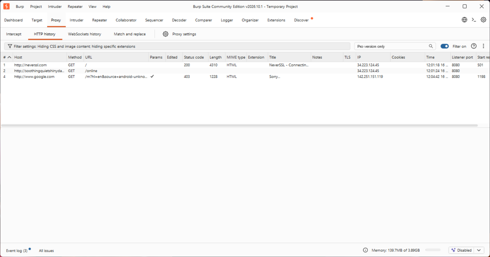
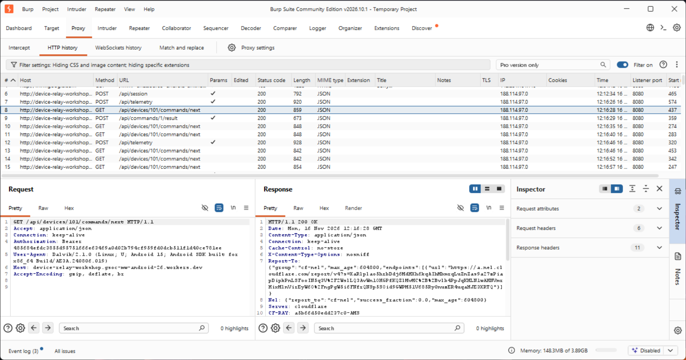
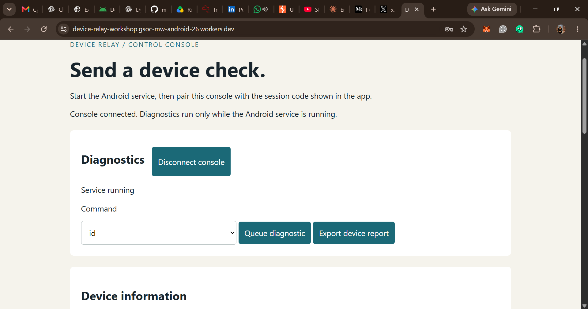

# Device Relay — Android Dynamic Analysis

## Overview

This case study documents a controlled dynamic assessment of the Device Relay Android application. The review focused on observing service behaviour, diagnostic requests, and network traffic from an Android emulator, with Burp Suite Community Edition used to inspect HTTP(S) traffic.

## Analysis Environment

- Host operating system: Windows 11
- Android Studio and Android Emulator
- Emulator device profile: Pixel 9 Pro
- Android version: 15 (API 35), x86_64
- Proxy tool: Burp Suite Community Edition
- Burp listener: `127.0.0.1:8080`
- Emulator proxy: `10.0.2.2:8080`
- Additional observation: Android Logcat and the Device Relay Web Console

**APK details**

- Filename: `device-relay-lab.apk`
- Size: 20,988 bytes
- SHA-256: `EE2D2367CF827880BE83C59EE099CFEC6A0F2D64E349C507399EC85437D79E0C`

## Methodology

1. Started the Android emulator and launched the application in the controlled test environment.
2. Configured the emulator to route traffic through the Burp proxy.
3. Used a browser proxy check to confirm that HTTP traffic could be observed.
4. Observed application requests and responses in Burp Suite.
5. Reviewed the application's diagnostic console and the commands it queued.
6. Stopped the application service and observed the resulting change in activity.

### Service startup

The application service was started in the emulator before the diagnostic and network observations were collected.

## Observations

### 1. Proxy connectivity

The WebView Browser Tester proxy check generated requests to `http://neverssl.com`. Burp captured requests for `/` and `/online`, both returning HTTP 200. This confirmed that the emulator's browser traffic was reaching the configured proxy.

### 2. Application network traffic

The application generated HTTPS requests to a `workers.dev` backend. Some observed responses returned **200 OK**, while others returned **401 Unauthorized**. The response codes were recorded as observed; the reason for the 401 responses was not independently established.

### 3. Diagnostic console

The Device Relay console exposed diagnostic commands including:

- `id`
- `uname -a`
- `uptime`
- `getprop ro.build.version.release`
- `getprop ro.build.version.security_patch`

These commands were visible in the diagnostic interface during the session.

### 4. Service stop behaviour

After the service was stopped through the application interface, the service status changed to stopped. A subsequent device-state request showed that the observed activity had stopped.

## Results and Interpretation

The assessment confirmed that the emulator proxy configuration was working and that application-related HTTPS traffic was observable during the session. It also documented the diagnostic interface and the observed effect of stopping the service.

The captured status codes are observations, not proof of the cause of a request failure. No conclusion is made about behaviour beyond the tested emulator session.

## Scope Limitations

The notification Stop action was unavailable during the test. Device ownership and behaviour outside the controlled test session were not independently assessed.

## Conclusion

The dynamic assessment documented application network activity, diagnostic interface behaviour, and the observed effect of stopping the service in a controlled emulator session. The findings are limited to the captured test evidence.
