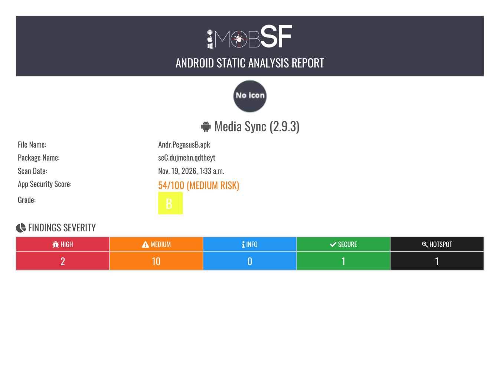
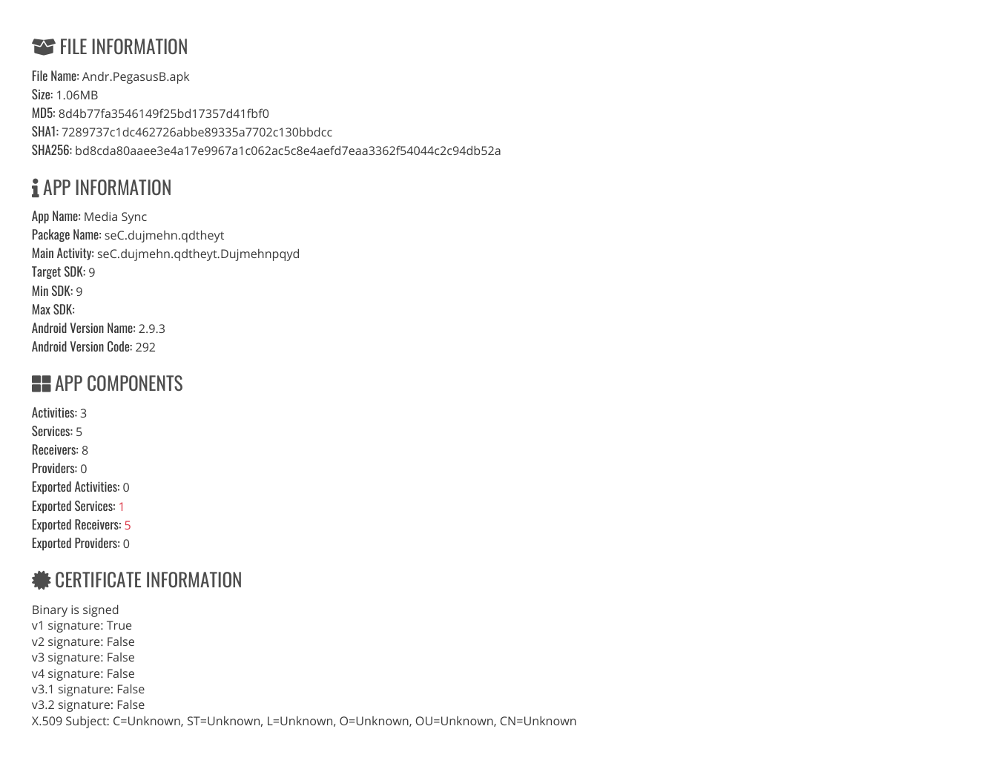
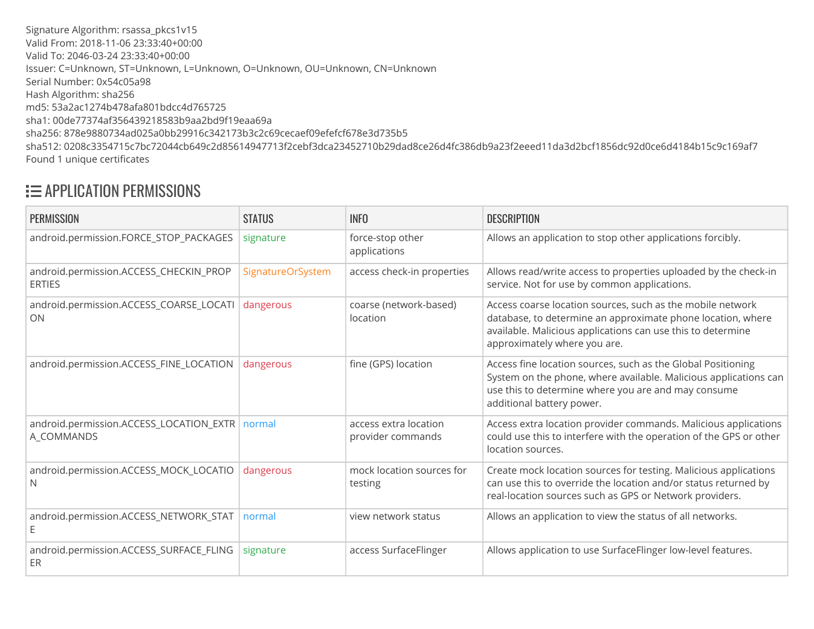
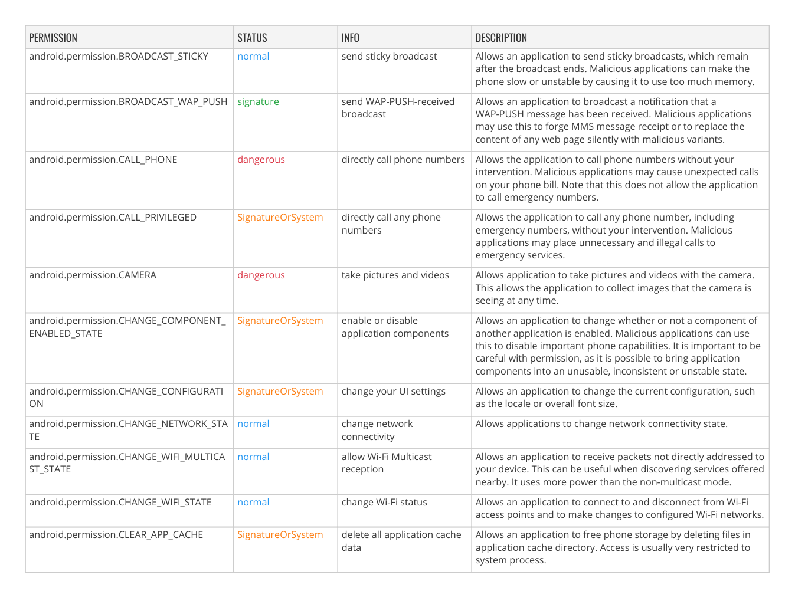
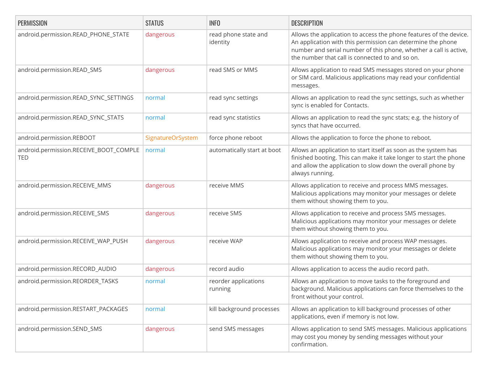
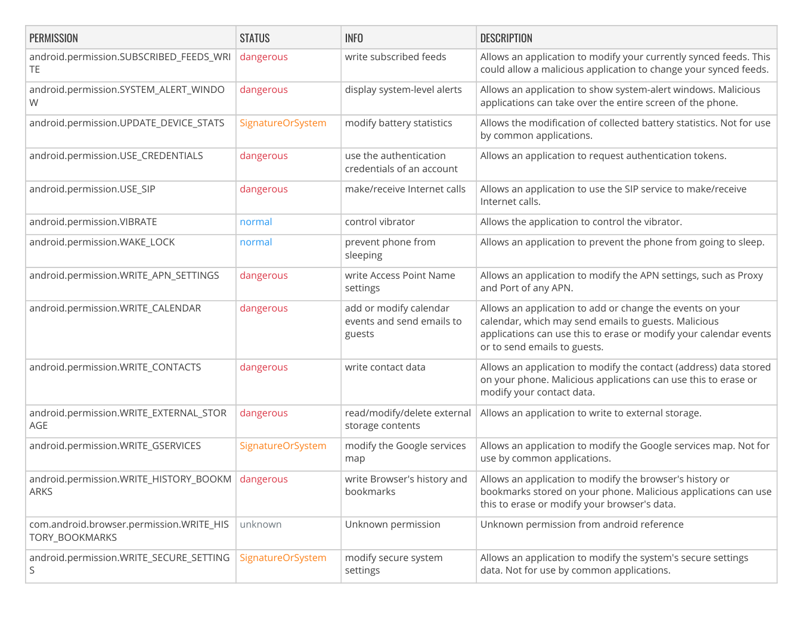
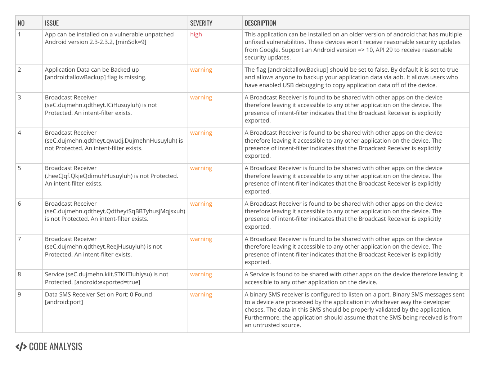
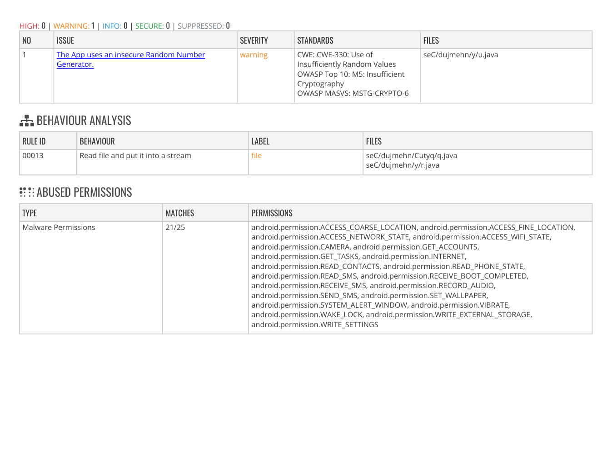
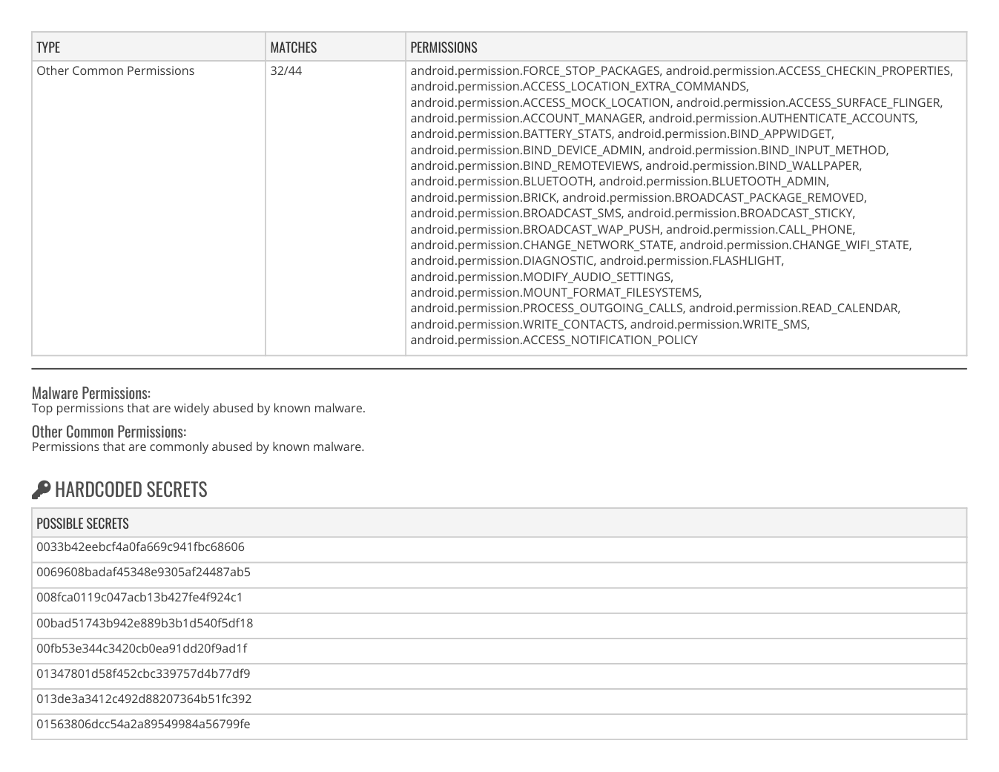

# Pegasus — MobSF Static Analysis

## Overview

This case study records a MobSF-based static analysis exercise involving an Android APK referred to during the assessment as **Pegasus**.

The label is used to identify the sample in the context of the exercise. It does not, by itself, establish that the APK is the Pegasus spyware product. Findings in this report will be limited to what can be confirmed from the MobSF report and supporting screenshots.

## Analysis Environment

- Analysis platform: Mobile Security Framework (MobSF)
- Application type: Android APK
- Analysis type: Static analysis

**Sample identification**

Add the APK filename, package name, version, and SHA-256 hash here after checking the original MobSF report.

## Methodology

1. Submitted the APK to MobSF for static analysis.
2. Reviewed the application information and manifest-related results.
3. Examined permissions, declared components, and broadcast receivers.
4. Reviewed MobSF security findings and supporting evidence.
5. Recorded observations without treating tool-generated risk labels as proof of malicious activity.

## Findings

This section will be completed after the MobSF report and screenshots are added. The exact receiver names, permissions, package metadata, and security findings must be transcribed from the evidence rather than reconstructed from memory.

### Broadcast receivers

The class exercise included a question about two broadcast receivers. The exact receiver declarations should be verified against the MobSF results before they are listed here.

### Other MobSF observations

Add confirmed findings here, including the relevant MobSF category and the evidence supporting each observation.

## Evidence and Screenshots

The following screenshots document the MobSF results reviewed during this static-analysis exercise.

### 1. Application overview

### 2. File and application components

### 3. Permissions: location and identity

### 4. Permissions: camera and call access

### 5. Permissions: SMS, boot and audio

### 6. Permissions: contacts and system access

### 7. Manifest and exported-component findings

### 8. Code behaviour and abused permissions

### 9. Malware and common-permission mapping

## Limitations

MobSF findings are indicators for investigation and should be interpreted in context. Static analysis alone does not prove that a component was executed, that a permission was abused, or that an APK is associated with a particular spyware operation.

## Conclusion

The final assessment will summarize only verified MobSF observations after the scan report and supporting evidence have been reviewed.
